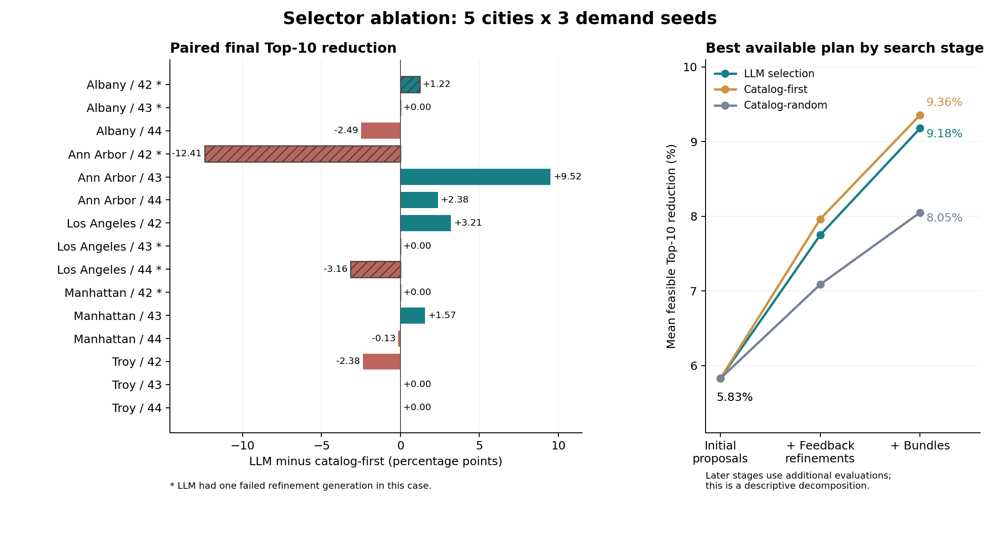

本次检查针对 2026-09-08 新增的 `experiment/selector-ablation`：5 个城市、需求种子 42/43/44，共 15 个配对案例。两个非 LLM 条件来自今天的新运行；LLM 条件复用 `luna-five-city-legal-mutation-seed4*` 中的 15 次历史运行，元数据记录的模型为 `gpt-5.6-luna`。Claude 是协助开展这次实验的工具，并不是这里被评测的选择器模型。

**核心判断：这次消融没有建立 LLM 变异选择相对目录启发式的稳定优势。它表明，当前框架的最终优化效果可以通过便宜的目录规则选择保留；LLM 在若干案例中有额外收益，但总体收益不足以抵消其他案例的损失和生成失败。** 这不能推导为所有交通优化任务中 LLM 都没有价值，也不能推导为两个选择器统计等效。

复算结果如下。Top-10 指基线冻结的十条目标道路上的时间损失；全网指标是平均车辆延误。所有均值包括最终选择 no-op 的案例，其改善记为零。成功指最终选择满足约束且 Top-10 改善至少 1% 的方案。

| 条件 | Top-10 改善，均值 ± 样本标准差 | 全网延误改善 | 最终成功 | 实际候选 SUMO 评估 | 仿真效率 |
|---|---:|---:|---:|---:|---:|
| LLM selection | 9.18% ± 10.18% | 2.78% | 13/15（86.7%） | 97/105 | 34/97 = 35.1% |
| Catalog-first | 9.36% ± 10.18% | 2.82% | 14/15（93.3%） | 103/105 | 40/103 = 38.8% |
| Catalog-random | 8.05% ± 10.28% | 2.60% | 11/15（73.3%） | 103/105 | 33/103 = 32.0% |

每个案例的候选仿真上限为 7，不含公共基线：3 个初始单动作，最多 2 个反馈细化，最多 2 个组合方案。仿真效率采用论文定义，即跨案例的“可行且改善的候选总数 / 实际评估总数”。

LLM 相对 Catalog-first 的平均差为 −0.177 个百分点，逐案例 5 胜、5 负、5 平；现有分析脚本的配对 Wilcoxon 检验 p=0.9594。相对 Catalog-random 的平均差为 +1.128 个百分点，6 胜、3 负、6 平，p=0.5147。这些是小样本探索性结果；同一城市的三个种子共享路网，不能当成 15 个完全独立的城市来解释。未检出差异不等于证明等效。

**实验配对与解释范围。** 逐案例核对的初始动作及非路径参数、初始候选仿真结果、冻结目标集、细化父方案和父方案反馈一致。搜索预算、beam 宽度、组合预算等关键参数一致。种子 44 的旧元数据显式记录 `proposal_seed=44`，新运行该字段为 null，但案例种子均为 44，初始动作和结果也相同；这不是实际初始化差异。不同运行目录造成的产物路径差异不应当作数值差异。

这次比原来的 proposal-source 对照更贴近“LLM 是否有额外贡献”：原对照同时改变了初始化之后的预算分配，而现在保持搜索结构相同，替换目录选择器。不过，这仍然是完整运行结果的比较；生成失败及随之变化的组合候选会影响最终结果，不能把最终差异全部解释为单次选择质量差异。

`agents/debate_optimizer.py` 的目录生成器已经包含反馈相关规则：信号控制优先尝试接近当前值的周期，限速参数根据是否违反安全约束调整排序，重路由比例也根据约束状态排序。因此 Catalog-first 是利用了领域规则和部分仿真反馈的基线。随机选择也在经过验证、目标筛选的合法目录中进行，其较好效果不能外推为任意随机交通干预都有效。

**收益来自哪里。** 从已有候选池提取每一阶段可行的最佳方案，可以得到：

| 条件 | 仅初始单动作 | 加入反馈细化单动作 | 再加入组合方案 |
|---|---:|---:|---:|
| LLM selection | 5.83% | 7.75% | 9.18% |
| Catalog-first | 5.83% | 7.96% | 9.36% |
| Catalog-random | 5.83% | 7.09% | 8.05% |

三个初始方案即可在 9/15 个案例找到符合成功定义的干预。后续搜索将其提高到 13/15、14/15、11/15；LLM 和 Catalog-first 各在 10/15 个案例中进一步提高了初始最佳值。这个分解是描述性的：后续阶段花了更多仿真，不能据此单独证明闭环结构优于同预算的其他搜索。更可靠的结论是，在目前的局部搜索结构中，LLM 可以被目录规则替换而保持相近的汇总效果。已有结果尚不能分别量化验证器、父方案选择、细化和组合模块各自的因果贡献。

**两个需要一起看的案例。** Ann Arbor / seed 43 中，LLM 改选信号灯控制位置，最终 Top-10 改善 14.88%，Catalog-first 为 5.36%。这说明模型有时能找到固定参数排序漏掉的更好目标。相邻的 seed 42 则相反：LLM 为 5.90%，Catalog-first 为 18.31%；LLM 的一次限速细化生成失败，另一信号位置变异不满足最终可行性条件，而规则选择产生了可行的周期细化及限速细化，组合后取得更大收益。这里同时存在选择质量、执行可靠性与组合机会的差异，不能只归因于少一次仿真。

LLM 的 24 个成功生成的细化中，7 次改信号位置、1 次改最小绿灯比例，没有一次改周期；Catalog-first 的 13 次信号细化全部改周期。这是值得检验的搜索偏好差异，尚不能说明哪一种策略具有普遍优势。

**生成可靠性确实影响结果。** LLM 的 30 次计划细化中有 6 次生成失败（20%），日志为非 JSON/空输出或输出长度限制错误；Catalog-first 和 Catalog-random 各完成 30 次。失败不是交通方案经过 SUMO 后被判无效，而是未产生可用选择。5 次失败发生在信号角色、1 次发生在限速角色。LLM 的 100% proposal validity 是对已经产出的候选计算的，不能当成 100% 请求成功率。

只看没有生成失败的 9 个案例，LLM / Catalog-first / Catalog-random 的平均 Top-10 改善为 9.76% / 8.46% / 6.67%。这是支持“值得进一步检查选择质量”的线索，但属于按结果事后划分子集，不能替代完整 15 案例的主结果。必须通过修复输出后重新运行，才能检验可靠性改善能否带来稳定优势。

**论文呈现需要统一的地方。**

- 原 proposal-source 实验中“LLM 成功率最高”的描述仅在原来三个条件内成立；加入 Catalog-first 后，应限制该表述的范围并报告新的消融结论。仅仅说明最终方案含有反馈细化，不足以证明这些收益由 LLM 独有地带来。
- `analyze_selector_ablation.py` 输出的效率 36.2% / 39.4% / 32.7% 是各案例效率的算术平均；论文主表采用合并分子分母的 35.1% / 38.8% / 32.0%。两者都可定义，但应明确名称并保持主表统一。
- `paper/generated/selector_ablation_table.tex` 目前只含两种新选择器，caption 仍是 proposal-source comparison，并与原表复用了 label。其 69.9% / 61.2% 是候选达到 1% 改善的比例，不能当作最终方案成功率 93.3% / 73.3%。尚未修改这些已有论文文件。
- 本实验只隔离目录选择器，不能证明多个专职 agent 优于一个共享信息的 agent；若多 agent 协作是论文核心贡献，需要另设同预算、同信息的单 agent 对照。

**下一步建议按以下顺序推进。**

1. 先建立可可靠执行的 LLM 条件：减少选择输出所需字段，确保能返回有效目录 ID，记录重试、时间和调用量；并设独立的“LLM 失败后 Catalog-first 兜底”条件。保留旧结果作为实际可靠性对照，重新运行固定案例和预算，检验模型增益是否被生成失败掩盖。不能直接把缺失结果补成规则结果，再称之为纯 LLM 条件。
2. 在几个差异最大的固定父方案上评估完整合法目录，计算每种选择器相对最佳可行变异的差距、可行率和模型所选项的排名。保持父方案及目录内容不变，再做目录顺序随机化、模型输入反馈遮蔽，检验模型是否利用了反馈以及是否受排序影响。该 oracle 只用于诊断，不能拿它的额外预算与主方法直接比较；单次变异排名也不能替代组合后的最终收益。
3. 扩充需求种子，并给同一需求设置多个独立选择器种子或 LLM 重复。当前随机选择器使用需求种子作 RNG 种子，不能分离需求变化与选择随机性。新规则或 prompt 应在保留场景上评估，避免用这 15 个案例调参后仍把它们作为泛化证据。
4. 若可靠性修复后仍无稳定优势，优先研究模型是否能更好地选择干预目标、在新约束下分配搜索预算，或提出经过验证的多参数候选；现有证据不支持直接假定扩大动作空间或换更大模型一定有效。工程默认值可以先以 Catalog-first 为基准，LLM 的新增成本应由额外收益支持。

本次重新执行了原分析脚本，独立汇总了全部 45 个运行的候选记录，并运行选择器相关现有测试（9 passed）。30 组新旧运行配对的基线 KPI 与诊断在归一化运行目录路径后相同；24 次成功生成的 LLM 选择对应的 48 组目录 ID 列表也相同。完整目录内容的逐项重建检查因耗时较长而中止，因此不把“历史目录内容逐字节完全相同”作为本次已完成的验证结论；顺序编号相同本身不构成内容相同的证明。没有重新运行 SUMO、调用被评测模型或修改原始实验结果。详细复算数据见 [JSON](selector_ablation_review_2026-09-08.json)，图可单独导出 [PDF](selector_ablation_review_2026-09-08.pdf)。
